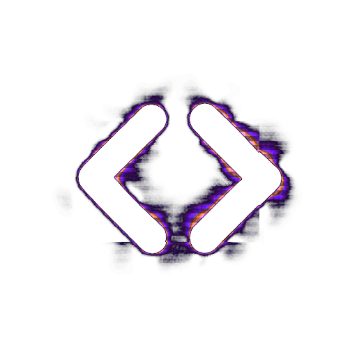
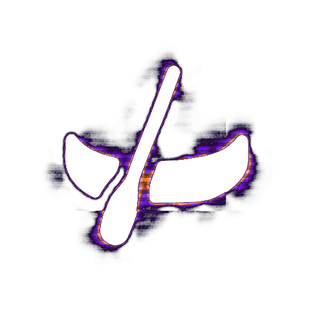
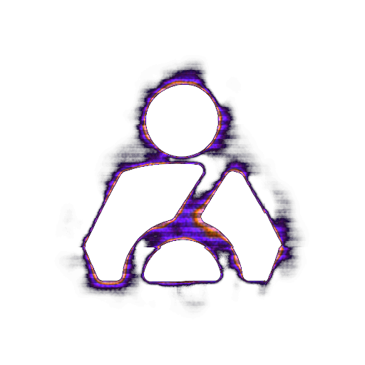

	

  
  
  
  

<table>
  <tr>
    <td colspan="2"><h3>Hey there, I'm Joshua</h3></td>
  </tr>
  <tr>
    <td width="64%" valign="top">
      
<b>Programmer, artist, entrepreneur, tinkerer, type nerd.</b> Computer science student at UVA.

      
I am passionate and obsessive about fitness, programming, business, and philosophy.

      
Outside of academia, I race on the triathlon team, surf and snowboard whenever I can, and read a lot about psychology and technology.

      
I'm currently looking for internships and job opportunities. Reach me at <a href="mailto:joshuamarkle25@gmail.com">joshuamarkle25@gmail.com</a> or check out my <a href="https://joshuamarkle.com/JoshuaMarkleResume.pdf">resume</a>.

    </td>
    <td width="36%" align="center"></td>
  </tr>
</table>

<h3 align="center">WORK</h3>

<table>
  <tr>
    <td width="50%" align="center" valign="top">
      
      <h3>GECKO</h3>
      
<i>Keyboard layouts, scored and searched.</i>

      
A keyboard optimizer in Rust. It scores any layout across 47 metrics, with a hand model for reach and wrist posture, then searches for better ones.

      
<a href="https://github.com/JoshuaMarkle/gecko"><b>SOURCE</b></a>

    </td>
    <td width="50%" align="center" valign="top">
      
      <h3>AlgoType</h3>
      
<i>A typing test made of real code.</i>

      
Type real solutions in five languages while it tracks speed and accuracy across more than 7,000 samples. Next.js and Supabase.

      
<a href="https://algotype.net"><b>LIVE</b></a> &nbsp;·&nbsp; <a href="https://github.com/JoshuaMarkle/algotype"><b>SOURCE</b></a>

    </td>
  </tr>
  <tr>
    <td width="50%" align="center" valign="top">
      
      <h3>JAGUAR</h3>
      
<i>Concrete canoes that float.</i>

      
A concrete canoe hull optimizer in Rust. It finds the lightest hull that survives its crew, checks strength, freeboard and stability, then races it.

      
<a href="https://github.com/JoshuaMarkle/jaguar"><b>SOURCE</b></a>

    </td>
    <td width="50%" align="center" valign="top">
      
      <h3>Milestone</h3>
      
<i>A driving log for new drivers.</i>

      
A driving log for learner's permit holders, built in Flutter. A national winner of the 2023 Congressional App Challenge, presented to Congress.

      
<a href="https://play.google.com/store/apps/details?id=com.joshuamarkle.milestone"><b>LIVE</b></a> &nbsp;·&nbsp; <a href="https://github.com/JoshuaMarkle/milestone"><b>SOURCE</b></a>

    </td>
  </tr>
</table>

<table width="100%">
  <tr>
    <td><b>Corne</b></td>
    <td>A split keyboard and its keymap.</td>
    <td align="right"><a href="https://github.com/JoshuaMarkle/corne">Source</a></td>
  </tr>
  <tr>
    <td><b>OpenGym</b></td>
    <td>A lifting and food log.</td>
    <td align="right"><a href="https://github.com/JoshuaMarkle/opengym">Source</a></td>
  </tr>
  <tr>
    <td><b>UVA Chatbot</b></td>
    <td>Career questions, answered.</td>
    <td align="right"><a href="https://uva-chatbot.vercel.app">Live</a> · <a href="https://github.com/JoshuaMarkle/chatbot">Source</a></td>
  </tr>
  <tr>
    <td><b>midi2furnace</b></td>
    <td>MIDI into a tracker.</td>
    <td align="right"><a href="https://github.com/JoshuaMarkle/midi2furnace">Source</a></td>
  </tr>
  <tr>
    <td><b>Fluid Simulation</b></td>
    <td>Particles that act like water.</td>
    <td align="right"><a href="https://github.com/JoshuaMarkle/fluid-simulation">Source</a></td>
  </tr>
  <tr>
    <td><b>Evolution Simulation</b></td>
    <td>Small cells, changing worlds.</td>
    <td align="right"><a href="https://tavyz.itch.io/evolution-simulator">Live</a> · <a href="https://github.com/JoshuaMarkle/evolution-simulation">Source</a></td>
  </tr>
  <tr>
    <td><b>Drone AI</b></td>
    <td>A drone that teaches itself to fly.</td>
    <td align="right"><a href="https://github.com/JoshuaMarkle/drone-ai">Source</a></td>
  </tr>
  <tr>
    <td><b>Pigedex</b></td>
    <td>A pigeon loft manager.</td>
    <td align="right"><a href="https://pigedex.joshuamarkle.com">Live</a> · <a href="https://github.com/JoshuaMarkle/pigedex">Source</a></td>
  </tr>
  <tr>
    <td><b>Sandwich</b></td>
    <td>Every assignment, one calendar.</td>
    <td align="right"><a href="https://github.com/JoshuaMarkle/sandwich">Source</a></td>
  </tr>
  <tr>
    <td><b>Dotfiles</b></td>
    <td>The desktop and the editor.</td>
    <td align="right"><a href="https://github.com/JoshuaMarkle/dotfiles">Source</a></td>
  </tr>
</table>

<h3 align="center">TOOLKIT</h3>

<table>
  <tr>
    <td align="right"><b>PROFICIENT</b></td>
    <td>
      
      
      
      
      
      
      
      
    </td>
  </tr>
  <tr>
    <td align="right"><b>FAMILIAR</b></td>
    <td>
      
      
      
      
      
      
      
    </td>
  </tr>
  <tr>
    <td align="right"><b>ENVIRONMENT</b></td>
    <td>
      
      
      
      
      
      
      
    </td>
  </tr>
  <tr>
    <td align="right"><b>WORKFLOW</b></td>
    <td>
      
      
      
      
      
      
      
    </td>
  </tr>
  <tr>
    <td align="right"><b>LEARNING</b></td>
    <td>
      
      
      
      
      
      
      
      
      
      
      
      
      
      
    </td>
  </tr>
</table>

